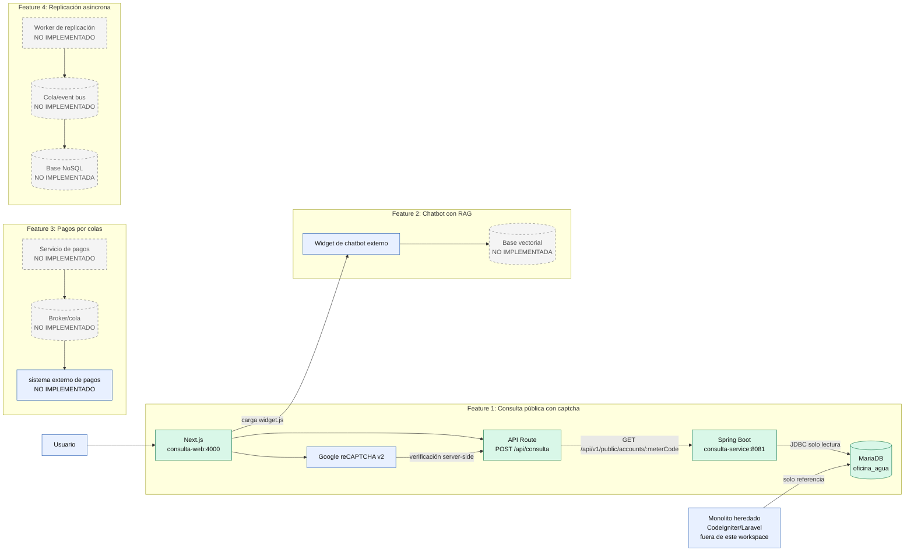

Nombre: Victor Daniel Sosa Lopez
Carnet: 0905-23-8230
Repositorio: https://github.com/Dansosa18/Consulta_Publica_Con_Captcha.git
Modulo asignado: Consulta pública con captcha

# Solución integrada de consulta pública

Este repositorio contiene la solución de la **consulta pública de estado de
cuenta** de la Oficina de Agua. La interfaz Next.js está en
[`consulta-web`](./consulta-web/), y el microservicio Spring Boot está en este
repositorio.

La documentación se basa en el código y la configuración presentes en ambos
proyectos. No se incluyen contraseñas, tokens, claves de API ni contenidos de
archivos `.env`.

## Arquitectura general

### Diagrama de arquitectura obligatorio

El siguiente diagrama representa la solución integrada y distingue con línea
continua los componentes implementados en este workspace de los componentes
que no están incluidos. Los nodos de colas, NoSQL y procesamiento de pagos
aparecen porque son features definidas para Fase 2, pero se marcan como
**no implementados aquí** para no presentar una arquitectura ficticia.



**Leyenda:** verde = componentes implementados en este workspace; azul =
usuario, monolito heredado o sistemas externos; gris discontinuo = componente
de una feature de Fase 2 que no existe en estos repositorios. Las flechas
continuas representan flujos implementados. Las flechas discontinuas
representan una frontera documentada o una integración prevista, no una
conexión ejecutable disponible en este código.

En la implementación disponible, el monolito heredado no se modifica y el
microservicio consulta una base MariaDB de desarrollo con el esquema y datos
ficticios necesarios para reproducir la consulta. No se encontró en estos
repositorios el código fuente del monolito, un broker de mensajes, un servicio
de pagos, un worker de replicación ni una base NoSQL. Si esos componentes se
entregan en repositorios adicionales, deben sustituirse en este diagrama por
sus nombres, bases y conexiones reales antes de presentar la solución
completa.

### Componentes y responsabilidades

| Componente | Responsabilidad | Comunicación |
| --- | --- | --- |
| `consulta-web` | Página pública, formulario, renderizado de resultados y mensajes de error. | El navegador llama a `/api/consulta`; no accede directamente a MariaDB. |
| API Route de Next.js | Valida el código del medidor, valida reCAPTCHA en el servidor, aplica el límite de tiempo del cliente y traduce las respuestas del backend. | `POST /api/consulta` hacia el navegador y `GET /api/v1/public/accounts/{meterCode}` hacia Spring Boot. |
| reCAPTCHA v2 | Reduce consultas automatizadas antes de consultar la cuenta. | La clave pública se usa en el navegador; la clave secreta solo se usa en la API Route para llamar a Google. |
| `consulta-service` | Expone el contrato OpenAPI y consulta el estado de cuenta mediante Spring Data JPA. | HTTP desde la API Route; JDBC hacia MariaDB. |
| MariaDB | Base de desarrollo con tablas de clientes, medidores, lecturas y pagos ficticios. | Se levanta con Docker Compose y el servicio usa un usuario de solo lectura. |
| Monolito heredado | Es la fuente de datos de la Oficina de Agua que no debe modificarse. En este workspace no se incluye su código; la base de desarrollo reproduce el esquema necesario para la consulta. | El microservicio consulta datos, no ejecuta operaciones de escritura. |
| Widget de chatbot | La web carga un `widget.js` externo después de la interacción. | Es una integración de frontend; este repositorio no contiene el motor RAG ni sus datos. |

El microservicio usa `ddl-auto=validate`, por lo que Hibernate valida el
esquema sin modificarlo. El endpoint público devuelve el nombre del titular
enmascarado, saldo pendiente, lecturas recientes y pagos recientes; no devuelve
dirección, teléfono u otros datos privados.

### Funcionalidades de Fase 2

El alcance comprobable de este repositorio es el módulo **Consulta pública con
captcha**. La siguiente tabla evita atribuir componentes que no existen en el
código revisado:

| Feature | Estado en este workspace |
| --- | --- |
| Consulta pública con captcha | Implementada en `consulta-web` y `consulta-service`. |
| Chatbot con RAG | La web solo carga un widget externo. No hay servicio RAG, base vectorial ni API de modelos en estos repositorios. |
| Envío de pagos a sistemas externos por colas | No hay productor, consumidor, broker ni sistema externo de pagos implementado aquí. |
| Replicación asíncrona a NoSQL | No hay worker, cola ni base NoSQL implementados aquí. |

## Flujo de integración

1. El usuario abre la página de Next.js e ingresa un código de medidor.
2. El navegador obtiene un token de reCAPTCHA v2 y envía el código y el token
   a `POST /api/consulta`.
3. La API Route valida longitud y caracteres permitidos, y verifica el token
   con Google usando la variable de entorno `RECAPTCHA_SECRET_KEY`.
4. El servidor Next.js llama al microservicio con
   `GET /api/v1/public/accounts/{meterCode}`. Las variables
   `CONSULTA_API_URL` e `INTERNAL_TOKEN` se mantienen del lado del servidor.
5. Spring Boot valida el contrato generado desde
   [`consulta-api.yaml`](./src/main/resources/openapi/consulta-api.yaml),
   busca el medidor, calcula el saldo y obtiene hasta seis lecturas y seis
   pagos recientes.
6. MariaDB responde mediante un usuario con permisos de lectura. El resultado
   vuelve por la misma cadena y Next.js lo presenta en la página.

El microservicio limita por defecto a 10 solicitudes por minuto por IP y
responde `429` con `Retry-After` cuando se excede el límite. La API Route
conserva esa respuesta para que la interfaz indique cuándo reintentar.

## Módulo: consulta pública con captcha

### Funcionalidad y objetivo

El módulo permite que un usuario consulte el estado de una cuenta usando el
código del medidor, sin iniciar sesión. Resuelve la necesidad de consultar
saldo, estado del medidor, lecturas y pagos recientes sin exponer el sistema
administrativo ni permitir escrituras sobre la base de datos. El captcha y el
límite por IP reducen el abuso del endpoint público.

### Integración y responsabilidades

- Next.js funciona como frontend y como BFF; el navegador no conoce las
  credenciales internas ni la conexión JDBC.
- La API Route es responsable de validar la entrada, verificar reCAPTCHA y
  normalizar errores del microservicio.
- Spring Boot concentra las reglas de consulta, el acceso JPA y el rate limit.
- MariaDB se usa con permisos de solo lectura; el monolito heredado no se
  modifica.
- El captcha secreto nunca se envía al navegador. Las variables de entorno se
  configuran localmente y no se versionan.

### Decisión técnica

Se eligió una API Route de Next.js como intermediaria en lugar de llamar al
microservicio directamente desde el navegador. Así se mantienen en el
servidor `RECAPTCHA_SECRET_KEY` e `INTERNAL_TOKEN`, se unifica el formato de
errores para la interfaz y se evita acoplar el cliente a la URL interna de
Spring Boot. El microservicio permanece separado para que la consulta pueda
validarse, limitarse y probarse independientemente del frontend.

También se eligió un usuario de MariaDB con permisos de solo lectura y
`ddl-auto=validate`: la consulta pública no puede cambiar datos y el servicio
no altera accidentalmente el esquema heredado.

## Ejecución local

### Requisitos

- Node.js y npm.
- Java 17 y Maven.
- Docker Desktop con Docker Compose.

### 1. Levantar MariaDB

Desde la raíz de `consulta-service`:

```powershell
Copy-Item dev-db/.env.example dev-db/.env
# Editar dev-db/.env y definir una contraseña local, sin versionar el archivo.
docker compose --env-file dev-db/.env -f dev-db/docker-compose.yml up -d
```

La base queda en `localhost:3307`, con datos ficticios cargados por los
scripts de `dev-db/init`.

### 2. Levantar el microservicio

En otra terminal, desde `consulta-service`:

```powershell
mvn spring-boot:run
```

El servicio queda disponible en `http://localhost:8081`.

### 3. Configurar y levantar Next.js

Desde la carpeta `consulta-web`, configura las variables localmente
(por ejemplo en `.env.local`):

```env
CONSULTA_API_URL=http://localhost:8081
INTERNAL_TOKEN=valor-local-compartido-con-consulta-service
NEXT_PUBLIC_RECAPTCHA_SITE_KEY=clave-publica-de-prueba
RECAPTCHA_SECRET_KEY=clave-secreta-de-prueba
DISABLE_CAPTCHA=false
NEXT_PUBLIC_DISABLE_CAPTCHA=false
```

La clave secreta y el token interno son ejemplos de configuración, no valores
para publicar. En producción deben reemplazarse por valores gestionados fuera
del repositorio.

Luego ejecuta:

```powershell
npm install
npm run dev
```

Abre `http://localhost:4000`.

## Prueba del módulo

1. Abre `http://localhost:4000`.
2. Escribe `CNT-0001`, completa el reCAPTCHA de prueba y presiona
   **Consultar**.
3. Verifica que aparezcan el titular enmascarado, estado del medidor, saldo,
   lecturas y pagos recientes.
4. Prueba `CNT-9999` y verifica el mensaje de cuenta no encontrada.
5. Prueba un valor con espacios o caracteres inválidos y verifica el error de
   validación.
6. Envía más de 10 consultas en un minuto desde la misma IP y verifica la
   respuesta de límite excedido y el tiempo de espera indicado.

Los códigos y saldos de prueba provienen de los seeds ficticios de
`dev-db/init`; no se requieren datos reales de usuarios.

